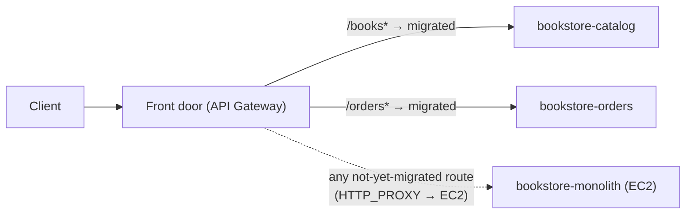
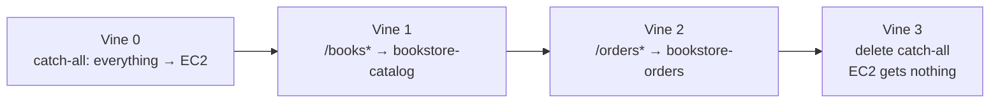

# Step 6 — HTTP API Front Door + Strangler Cutover

This is the heart of the migration. You put **one front door** in front of both worlds and
move traffic **route by route** from the monolith to the serverless slices. This is the
**Strangler Fig pattern**. Nobody flips a single switch that swaps the whole app. First the
front door sends *everything* to the monolith. Then you take over `/books*` and watch it, then
`/orders*`, and finally you remove the monolith's last route.

---

## 6.1 The Strangler Fig idea

A strangler fig grows around a host tree and takes over its structure. Eventually the host rots
away and the fig is left standing. In software you do the same: build the new system **around**
the old one, redirect functionality piece by piece, and retire the old system only when it
serves nothing.



The front door is an **API Gateway HTTP API**. Routes you've migrated integrate with a
**Lambda**. Everything else hits a catch-all **HTTP_PROXY** integration that forwards to the
EC2 instance. The *client* sees one stable URL the whole time. Only what's behind it changes.

You'll grow the vines in four moves, checking after each one:



| After… | `/books*` served by | `/orders*` served by | Anything else (`/health`) |
|--------|---------------------|----------------------|---------------------------|
| Vine 0 | monolith | monolith | monolith |
| Vine 1 | **`bookstore-catalog`** | monolith | monolith |
| Vine 2 | `bookstore-catalog` | **`bookstore-orders`** | monolith |
| Vine 3 | `bookstore-catalog` | `bookstore-orders` | **`404`**, monolith unreachable |

Every response body carries a `version` field (`monolith-1.0`, `catalog-1.0`, `orders-1.0`).
That's how you'll *see* which world served each request.

---

## 6.2 Build the front door (no routes yet)

You create the API, its stage, and one Lambda integration per function. You **don't** create
any routes yet. Routes are what you'll move, one vine at a time.

### Console

1. **API Gateway → Create API → HTTP API → Build.**
2. **Integrations:** leave empty. **API name:** `bookstore-api` → **Next**.
3. **Configure routes:** leave empty → **Next**.
4. **Define stages:** keep the pre-filled `$default` stage with **Auto-deploy** on → **Next →
   Create**.
5. Note the **Invoke URL** (`https://<api-id>.execute-api.us-east-1.amazonaws.com`).

In the Console you attach each Lambda integration when you create its route (Vines 1 and 2),
and the Console adds the invoke permission for you at that point.

### CLI alternative

```bash
API_ID=$(aws apigatewayv2 create-api --name bookstore-api \
  --protocol-type HTTP --query ApiId --output text)
ACCOUNT_ID=$(aws sts get-caller-identity --query Account --output text)

# The CLI does NOT create a stage for you (the Console does). Without one, every request
# returns {"message":"Not Found"} — which looks exactly like a broken route.
# Quote '$default' so the shell doesn't expand it to an empty string.
aws apigatewayv2 create-stage --api-id $API_ID --stage-name '$default' --auto-deploy

CAT_ARN=arn:aws:lambda:us-east-1:${ACCOUNT_ID}:function:bookstore-catalog
ORD_ARN=arn:aws:lambda:us-east-1:${ACCOUNT_ID}:function:bookstore-orders

# One integration per function, reused by that function's routes later
CAT_INT=$(aws apigatewayv2 create-integration --api-id $API_ID \
  --integration-type AWS_PROXY --integration-uri $CAT_ARN \
  --payload-format-version 2.0 --query IntegrationId --output text)
ORD_INT=$(aws apigatewayv2 create-integration --api-id $API_ID \
  --integration-type AWS_PROXY --integration-uri $ORD_ARN \
  --payload-format-version 2.0 --query IntegrationId --output text)

# Let API Gateway invoke each function. The trailing * covers BOTH /books and
# /books/{id} — without it, the single-book route gets a 500 "not authorized".
aws lambda add-permission --function-name bookstore-catalog \
  --statement-id apigw-catalog --action lambda:InvokeFunction \
  --principal apigateway.amazonaws.com \
  --source-arn "arn:aws:execute-api:us-east-1:${ACCOUNT_ID}:${API_ID}/*/*/books*"
aws lambda add-permission --function-name bookstore-orders \
  --statement-id apigw-orders --action lambda:InvokeFunction \
  --principal apigateway.amazonaws.com \
  --source-arn "arn:aws:execute-api:us-east-1:${ACCOUNT_ID}:${API_ID}/*/*/orders*"

BASE="https://${API_ID}.execute-api.us-east-1.amazonaws.com"
curl $BASE/books
# {"message":"Not Found"}  <- expected: the door exists, but no route goes anywhere yet
```

> **Why `--auto-deploy`?** Without it, every route change needs a separate
> `create-deployment` before it goes live. With it, each vine takes effect the moment you
> create or delete a route, which is what makes the cutover feel like flipping individual
> switches.

> **Why HTTP API (not REST)?** It's cheaper ($1.00 vs $3.50 per million requests), has lower
> latency, and sends the payload v2.0 shape your handlers already expect. The
> [HTTP-API CRUD project](../../../../intermediate/aws/aws-api-gateway-dynamodb-crud/README.md)
> covers it in depth.

---

## 6.3 Vine 0 — Put the monolith behind the front door

Before you migrate anything, the front door has to serve the *existing* app, so clients can
switch to the new URL with nothing changing behind it. One catch-all route does that:
`ANY /{proxy+}` → HTTP_PROXY → `http://<ec2-ip>:5000/{proxy}`.

### First, let API Gateway reach the instance

In Step 1 you opened port 5000 to *your own IP only*. API Gateway connects to your instance
from AWS's network, not from your laptop. Until you allow it, every catch-all request returns
`503 Service Unavailable`. AWS publishes API Gateway's address ranges in `ip-ranges.json`
(service `API_GATEWAY`, about 16 CIDRs for `us-east-1`). Allow those, not the whole internet:

```bash
SG=<sg-id>    # the monolith's security group from Step 1
PERMS=$(curl -s https://ip-ranges.amazonaws.com/ip-ranges.json | python3 -c "
import json, sys
d = json.load(sys.stdin)
cidrs = sorted({p['ip_prefix'] for p in d['prefixes']
                if p['service'] == 'API_GATEWAY' and p['region'] == 'us-east-1'})
print(json.dumps([{'IpProtocol': 'tcp', 'FromPort': 5000, 'ToPort': 5000,
                   'IpRanges': [{'CidrIp': c, 'Description': 'API_GATEWAY us-east-1'} for c in cidrs]}]))")
aws ec2 authorize-security-group-ingress --group-id $SG --ip-permissions "$PERMS"
```

> Console-only readers: adding 16 rules by hand is tedious. Open **CloudShell** (the `>_` icon
> in the Console header) and paste the block above. CloudShell already has your credentials.

> **Security note.** These ranges are **shared by every API Gateway customer** in the region,
> and AWS changes them over time. So this narrows exposure compared with `0.0.0.0/0`, but it is
> not authentication. Someone else's API could reach your plaintext, unauthenticated app. That's
> fine for a throwaway lab instance you terminate in Step 7, and **not** something to imitate
> in production. The production-safe shape is a **VPC Link** (private integration to an ALB or
> NLB inside your VPC), so the monolith never needs a public listener at all.

### Create the catch-all

**Console:** `bookstore-api` → **Develop → Routes → Create** → method **ANY**, path
`/{proxy+}` → **Create**. Select the route → **Attach integration → Create and attach an
integration** → type **HTTP URI**, method **ANY**, URL `http://<ec2-ip>:5000/{proxy}` →
**Create**.

**CLI:**

```bash
IP=<ec2-public-ip>
PROXY_INT=$(aws apigatewayv2 create-integration --api-id $API_ID \
  --integration-type HTTP_PROXY --integration-method ANY \
  --integration-uri "http://${IP}:5000/{proxy}" \
  --payload-format-version 1.0 --query IntegrationId --output text)
aws apigatewayv2 create-route --api-id $API_ID \
  --route-key 'ANY /{proxy+}' --target "integrations/$PROXY_INT"
```

Two things trip people up here:

- **`--integration-method` is required** for `HTTP_PROXY` (it's optional for Lambda).
- **HTTP_PROXY integrations use payload format 1.0**, not the 2.0 your Lambdas use.

### Verify: the front door serves the old app

```bash
curl $BASE/health    # {"status":"ok","version":"monolith-1.0"}
curl $BASE/books     # ... "version":"monolith-1.0"  <- still the monolith
```

From now on, point clients at `$BASE` instead of `http://<ec2-ip>:5000`. That's the only change
a client ever has to make in the whole migration.

> **Can't or won't open the port?** Skip Vine 0 and Vine 3. Vines 1 and 2 still work. They just
> become verification checkpoints instead of a live cutover, because nothing behind the front
> door reaches the monolith. You can still reach the monolith directly from your own IP for the
> parity check in 6.7.

---

## 6.4 Vine 1 — Strangle `/books*`

Add the two catalog routes. Because API Gateway **prefers the most specific match**, these
take over from the catch-all immediately, and everything else keeps going to EC2.

**Console:** **Routes → Create** `GET /books` and `GET /books/{id}`. For each one, **Attach
integration → Create and attach** → type **Lambda function** → `bookstore-catalog`.

**CLI:**

```bash
aws apigatewayv2 create-route --api-id $API_ID --route-key 'GET /books'      --target "integrations/$CAT_INT"
aws apigatewayv2 create-route --api-id $API_ID --route-key 'GET /books/{id}' --target "integrations/$CAT_INT"
```

**Verify. Same URL, different world:**

> **Give it ~5 seconds.** Auto-deploy isn't instantaneous. If you `curl` the moment the route is
> created, you can still get `monolith-1.0` for a request or two. That's propagation, not a
> broken route, and it applies to every vine (and to rollback).

```bash
curl $BASE/books                 # "version": "catalog-1.0"   <- now Lambda
curl $BASE/books/<book-id>       # one book, from DynamoDB
curl $BASE/health                # "version":"monolith-1.0"   <- still EC2 via the catch-all
curl -X POST $BASE/orders -H 'content-type: application/json' \
  -d '{"book_id":"<book-id>","qty":1}'   # 201 — but placed on the MONOLITH (SQLite)
```

Note the id of that last order. It was written to **SQLite**, not DynamoDB, because `/orders*`
hasn't moved yet. That matters in Vine 2 and in Step 7.

Watch `bookstore-catalog`'s CloudWatch metrics (Invocations, Errors) for a few minutes.

> **Rollback is one command.** If the catalog Lambda misbehaves, delete its two routes and
> `/books*` falls straight back through the catch-all to the monolith. No DNS change, no
> redeploy. That instant, per-route undo is the real reason to strangle instead of rewrite.
>
> ```bash
> aws apigatewayv2 get-routes --api-id $API_ID --query "Items[?starts_with(RouteKey,'GET /books')].RouteId" --output text
> aws apigatewayv2 delete-route --api-id $API_ID --route-id <route-id>   # for each
> ```

---

## 6.5 Vine 2 — Strangle `/orders*`

**Console:** **Routes → Create** `POST /orders` and `GET /orders/{id}`. Attach a **Lambda
function** integration to each → `bookstore-orders`.

**CLI:**

```bash
aws apigatewayv2 create-route --api-id $API_ID --route-key 'POST /orders'     --target "integrations/$ORD_INT"
aws apigatewayv2 create-route --api-id $API_ID --route-key 'GET /orders/{id}' --target "integrations/$ORD_INT"
```

**Verify:**

```bash
curl -X POST $BASE/orders -H 'content-type: application/json' \
  -d '{"book_id":"<book-id>","qty":1}'   # 201 — now in DynamoDB
curl $BASE/orders/<new-order-id>          # "version": "orders-1.0"
curl $BASE/orders/<vine-1-order-id>       # 404 {"error": "not found"}  <- !
curl $BASE/health                         # still the monolith
```

**That `404` is the most important thing in this step.** The order you placed during Vine 1
exists only in SQLite. Moving the *route* didn't move the *data*. Traffic cutover and data
cutover are two separate jobs. Step 7 closes the gap by re-running the idempotent exporter
(and proving nothing was lost). In production you'd keep this window short, or dual-write
during it.

> **About the `content-type` header.** Without a JSON content-type (e.g. a bare `curl -d`),
> HTTP API **base64-encodes the request body** and sets `isBase64Encoded: true`. The monolith's
> `get_json(force=True)` accepted such requests, so `bookstore-orders` decodes base64 bodies
> too. A handler that skips this returns `500` instead of the monolith's `400`/`201`, which
> breaks parity.

---

## 6.6 Vine 3 — Remove the catch-all (cutover complete)

Both domains are now served by Lambda, and only unmigrated paths like `/health` still reach EC2.
Nothing a client needs is left there, so delete the catch-all rather than keep it "just in
case". That deletion *is* the cutover completing.

**Console:** **Routes →** `ANY /{proxy+}` → **Delete**.

**CLI:**

```bash
RID=$(aws apigatewayv2 get-routes --api-id $API_ID \
  --query "Items[?RouteKey=='ANY /{proxy+}'].RouteId" --output text)
aws apigatewayv2 delete-route --api-id $API_ID --route-id $RID

curl $BASE/health    # {"message":"Not Found"}  <- no route points at EC2 any more
curl $BASE/books     # still "catalog-1.0"
```

> **Deleting a route does not delete its integration.** The HTTP_PROXY integration stays behind,
> unattached, and could be wired up again by accident. It costs nothing, and Step 8 removes it
> along with the whole API, so you can leave it. If you want the tidy version:
>
> ```bash
> aws apigatewayv2 get-integrations --api-id $API_ID \
>   --query "Items[?IntegrationType=='HTTP_PROXY'].IntegrationId" --output text
> aws apigatewayv2 delete-integration --api-id $API_ID --integration-id <id>
> ```

The API Gateway security-group rules from Vine 0 can stay too. The instance is retired in
Step 7 and the group is deleted in Step 8.

---

## 6.7 Verify parity

Run the same requests against the **old** monolith URL (still reachable from your IP) and the
**new** API URL, and confirm the responses match. Parity is your signal that it's safe to
retire the host tree.

| Check | Monolith `http://<ip>:5000` | API `https://<api-id>...` |
|-------|------------------------------|----------------------------|
| `GET /books` | 3 books | same 3 books |
| `GET /books/{id}` (bad id) | 404 | 404 |
| `POST /orders` (valid) | 201 + id | 201 + id |
| `POST /orders` (bad id) | 400 | 400 |
| `GET /orders/{id}` (bad id) | 404 | 404 |

**Don't just eyeball the status codes. Compare the bodies.** Status-code parity is easy; it's
the *shape* of the JSON that silently breaks clients. Let the machine check it:

```bash
python3 - <<'EOF'
import json, urllib.request
mono = json.load(urllib.request.urlopen("http://<ec2-ip>:5000/books/<book-id>"))
api  = json.load(urllib.request.urlopen("https://<api-id>.execute-api.us-east-1.amazonaws.com/books/<book-id>"))
print("monolith:", mono)
print("api     :", api)
print("identical:", mono == api)
EOF
```

You want `identical: True`. Compare a **single book**, as above, not the `GET /books` list.
The list body carries a `version` field (`monolith-1.0` vs `catalog-1.0`), and DynamoDB
`Scan` doesn't return items in SQLite's order, so the raw lists never compare equal even when
every book matches. To compare lists, compare `sorted(body["books"], key=lambda b: b["id"])`
on each side.

The classic way this fails is **numbers coming back as strings**: `"price": "39.99"` instead
of `"price": 39.99`. DynamoDB hands numbers to Python as `Decimal`, which `json.dumps` can't
serialise. The lazy fix (`default=str`) turns every number into a string and quietly breaks the
contract. The handlers in `src/` avoid this with a small `_json_default` that converts
`Decimal` back to `int`/`float`. See the troubleshooting entry **"`price` comes back as a
string"** if you hit it in your own code.

> **Why this matters more than it looks.** "Backward compatibility during migration" is the
> principle that lets the front door switch traffic safely. If the new slice returns a
> different *type*, a client doing `price * qty` starts throwing, and it'll happen in
> production after cutover, not here.

---

## Checkpoint

- [ ] Vine 0: `$BASE/health` and `$BASE/books` returned `monolith-1.0` through the front door
- [ ] Vine 1: `$BASE/books` switched to `catalog-1.0` while `/health` stayed on the monolith
- [ ] Vine 2: `/orders*` served by `bookstore-orders`, and you saw the Vine-1 order `404` (and know why)
- [ ] Vine 3: catch-all deleted; `$BASE/health` returns `404`
- [ ] Responses match the monolith's (parity confirmed)
- [ ] You can explain the strangler fig pattern, and why route cutover ≠ data cutover, in one sentence each

---

**Next:** [Step 7 — Decommission the Monolith](./07-decommission-monolith.md)
